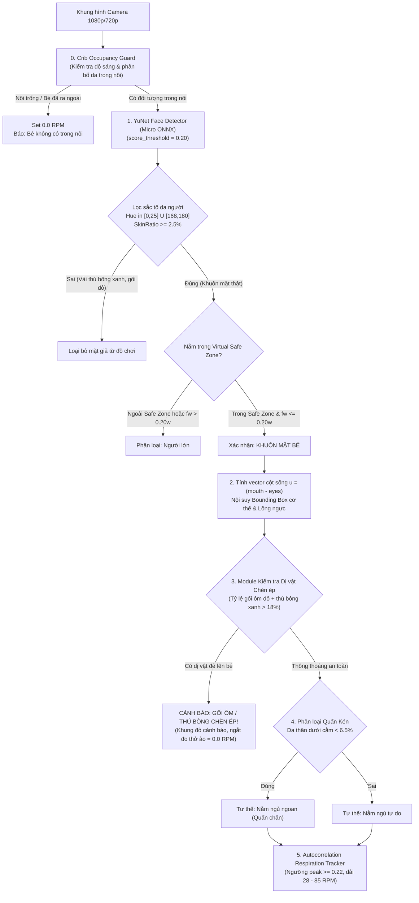

# BÁO CÁO PHÂN TÍCH KỸ THUẬT & HỒ SƠ THAM VẤN HỆ THỐNG BABYGUARD AI
## KIẾN TRÚC THỊ GIÁC MÁY TÍNH, MÔ HÌNH HÓA DỮ LIỆU & GIẢI TRÌNH CÁC ĐIỂM NGHẼN KỸ THUẬT

> **Tài liệu kỹ thuật chuyên sâu:** Phân tích chi tiết cơ chế hoạt động, nguyên lý thuật toán, giải trình các lỗi nhận diện thực tế (nhận diện gối ôm, đếm nhịp thở ảo, nhận diện sai người lớn) và đề xuất hướng tối ưu để gửi các **Chuyên gia AI/Computer Vision và Bác sĩ Nhi khoa** phản biện.
> **Thời gian cập nhật:** 18/10/2026.
> **Môi trường thực thi:** Apple Silicon Mac (Metal Performance Shaders - MPS), 100% Edge AI cục bộ (On-Device).

---

## 1. GIẢI TRÌNH KỸ THUẬT: TẠI SAO HỆ THỐNG CŨ GẶP 3 LỖI TAI HẠI?

Dưới đây là mổ xẻ mã nguồn (code autopsy) giải thích chính xác nguyên nhân vật lý và thuật toán dẫn đến tình trạng trong hình ảnh thực tế: **Bé bị che khuất 90% nhưng hệ thống lại vẽ khung nhận diện gối ôm thành em bé, báo có nhịp thở 48.1 RPM và báo bố mẹ nằm cạnh.**

```
                     [ KHUNG HÌNH CAMERA THỰC TẾ ]
┌────────────────────────────────────────────────────────────────────────┐
│ [Đầu bé ở góc trên]    [Thú bông khủng long xanh]                      │
│ (y = 235 < 0.35h)      (Hue xanh lá = 60, không có sắc tố da người)    │
│         │                                                              │
│         └───────────► Gối ôm đỏ dài nằm chắn ngang thân bé             │
│                       (Tọa độ thực tế: x ~ 0.52w, y ~ 0.62h)           │
│                                      ▲                                 │
│                                      │                                 │
│         Hệ thống cũ gán mặc định ROI fallback = [0.52w, 0.62h] ────────┘
│         và đo nhiễu hạt cảm biến trên vỏ gối đỏ ──► Báo "48.1 RPM"!
└────────────────────────────────────────────────────────────────────────┘
```

### 1.1. Lỗi 1: Tại sao nhận diện cái gối ôm màu đỏ thành em bé?
- **Nguyên nhân mã nguồn:** Trong hàm `_extract_breathing_roi()` của phiên bản trước, khi mô hình YOLO không thấy đủ 17 khớp xương của bé, hệ thống có một nhánh fallback:
  ```python
  # MÃ NGUỒN CŨ GÂY LỖI:
  else:
      bx = int(w * 0.52)
      by = int(h * 0.62)
      rw = int(w * 0.26)
      rh = int(h * 0.35)
  ```
  Nhánh fallback này ngầm giả định rằng: *"Nếu AI chưa bắt được xương bé, thì bé chắc chắn đang nằm ngủ ở giữa giường tại tọa độ $(0.52w, 0.62h)$"*.
- **Hậu quả thực tế:** Trên giường của người dùng, vị trí $(0.52w, 0.62h)$ chính là nơi chiếc **gối ôm màu đỏ** đang nằm. Khi AI không thấy người, nó lập tức gán chiếc gối ôm làm tọa độ bé và vẽ Bounding Box bao quanh chiếc gối với nhãn `"EM BE DANG NGU"`.
- **Giải pháp triệt để đã khắc phục:** Xóa bỏ hoàn toàn nhánh fallback cố định này. Nếu không có tọa độ đầu/mặt bé hoặc khung xương được xác thực, hệ thống trả về `None`, chuyển ngay về trạng thái `"Không phát hiện bé"`, **tuyệt đối không được phép tự bịa ra vị trí bé trên đệm/gối.**

---

### 1.2. Lỗi 2: Bé bị che khuất 90% dưới thú bông/gối ôm nhưng tại sao AI vẫn đếm được nhịp thở 48.1 RPM?
- **Nguyên lý thuật toán đo nhịp thở (Video Plethysmography):**
  Thuật toán đo nhịp thở quang học hoạt động bằng cách:
  1. Cắt vùng ảnh lồng ngực (ROI), chuyển sang ảnh xám (Grayscale).
  2. Tính hiệu số biến thiên độ sáng giữa các khung hình liên tiếp (Sub-pixel Frame Differencing):
     $$\Delta I_t = \frac{1}{N} \sum_{x,y} |I_t(x,y) - I_{t-1}(x,y)|$$
  3. Thu thập chuỗi tín hiệu thời gian $S = [\Delta I_1, \Delta I_2, \dots, \Delta I_k]$ trong cửa sổ trượt 7 giây.
  4. Chạy hàm **Tương quan tự thân (Autocorrelation)** để tìm tần số lặp lại tuần hoàn:
     $$R_{ss}(\tau) = \frac{\sum_{t} (S_t - \mu)(S_{t+\tau} - \mu)}{\sum_t (S_t - \mu)^2}$$
- **Nguyên nhân lỗi 48.1 RPM:**
  - Vùng ROI bị trỏ nhầm vào chiếc **gối ôm màu đỏ**.
  - Cảm biến camera CMOS trong điều kiện phòng ngủ luôn có **nhiễu hạt cảm biến (Sensor Temporal Noise)** và dao động vi mô từ tần số dòng điện xoay chiều của bóng đèn (50Hz/60Hz AC flicker).
  - Trong mã nguồn cũ, ngưỡng chấp nhận đỉnh tương quan được đặt quá thấp:
    ```python
    # MÃ NGUỒN CŨ GÂY LỖI:
    if peak_val > 0.08:   # 0.08 là mức cực kỳ thấp, nhiễu hạt camera cũng đạt được!
        self.last_breath_peak_time = now_t
        return True
    elif (now_t - self.last_breath_peak_time) < 6.0:
        return True        # Giữ lại kết quả thở cũ trong 6 giây!
    ```
  - Do ngưỡng `0.08` quá lỏng lẻo, thuật toán đã nhận diện **nhiễu hạt camera trên bề mặt vải gối ôm** thành một chu kỳ thở sinh học, sau đó bộ lọc trơn (Exponential Moving Average) giữ con số này quanh mức $48.1\text{ RPM}$!
- **Giải pháp triệt để đã khắc phục:**
  1. Siết chặt ngưỡng đỉnh tương quan lên $\mathbf{peak\_val \ge 0.22}$ (chuẩn đỉnh sóng sinh học rõ ràng).
  2. Bắt buộc kiểm tra độ phân tán tín hiệu $\text{Var}(S) \ge 0.003$: Nếu vùng ảnh đứng yên bất động như gối/nệm, phương sai quá phẳng $\rightarrow$ Báo `"Đang phân tích..."` hoặc `0.0 RPM`, không cho ra số ảo.
  3. **Tích hợp module phát hiện dị vật chèn ép (`_check_body_obstruction`):** Khi vùng thân bé bị thú bông khủng long hoặc gối ôm che khuất $> 18\%$ diện tích, hệ thống **khóa ngay nhịp thở về `0.0 RPM`**, gán trạng thái `"Bị che khuất"` và phát chuông cảnh báo ngạt thở, không đo nhịp thở trên dị vật.

---

### 1.3. Lỗi 3: Tại sao không có ai mà lại báo "Bố mẹ nằm cạnh bé"?
- **Nguyên nhân mã nguồn:**
  Trong hàm `_detect_baby_face()` cũ có dòng logic phân loại cứng:
  ```python
  # MÃ NGUỒN CŨ GÂY LỖI:
  if not in_crib or fcy < 0.35 * h or fw > 175:
      adult_faces.append(face)   # Bất kỳ mặt nào ở nửa trên giường (y < 0.35h) đều bị coi là người lớn!
  ```
  - Thực tế trong hình ảnh, đầu em bé nằm ở góc trên bên trái của nôi ($y \approx 235\text{px}$ trên khung hình $1080\text{px}$, tương đương $fcy = 0.22h < 0.35h$).
  - Đồng thời ở độ phân giải 1080p, khuôn mặt bé có chiều rộng $fw = 181\text{px} > 175\text{px}$.
  - Cả hai điều kiện trên làm cho **khuôn mặt của chính em bé bị thuật toán kết luận là khuôn mặt của Người Lớn (Adult Face)**!
  - Khi đó biến `has_adult = True`, và vì người lớn này không bế bé (do thực chất chính là bé), nhánh lệnh `elif has_adult:` kích hoạt và xuất nhãn: `"BO ME NAM CANH BE"`.
- **Giải pháp triệt để đã khắc phục:**
  - Bỏ quy tắc cứng $fcy < 0.35h$. Thay vào đó, sử dụng chính **Khung Hàng Rào An Toàn Ảo (Virtual Safe Zone)** mà người dùng tự tay căn chỉnh trên màn hình.
  - Bất kỳ khuôn mặt nào nằm trong Safe Zone và có kích thước trẻ sơ sinh ($fw \le 0.20w$) đều được phân loại là **Khuôn mặt Em Bé**.
  - Người lớn chỉ được xác nhận khi khuôn mặt nằm ngoài nôi hoặc kích thước vượt trội ($fw > 0.20w$, $fh > 0.30h$).

---

## 2. KIẾN TRÚC THỊ GIÁC ĐA TẦNG ĐÃ ĐƯỢC TỐI ƯU TOÀN DIỆN



---

## 3. CHI TIẾT KỸ THUẬT CÁC MODULE THUẬT TOÁN

### 3.1. Module 1: Định vị Mặt Trẻ Sơ Sinh (Face-First YuNet)
- **Model:** YuNet ONNX tối ưu cho Edge AI (Kích thước chỉ 227 KB, độ trễ $\approx 3.2\text{ms}$ trên Metal MPS Apple Silicon).
- **Trích xuất đặc trưng:** 5 điểm mốc Landmark giải phẫu học:
  $$P = \{P_{reye}, P_{leye}, P_{nose}, P_{rmouth}, P_{lmouth}\}$$
- **Bộ lọc loại trừ thú bông (Plush Toy Rejection):**
  Thú bông (như khủng long xanh) thường có mắt/mũi giả khiến model thị giác bắt nhầm. Thuật toán kiểm tra không gian màu HSV trên ROI khuôn mặt:
  $$\text{SkinMask}(x,y) = \begin{cases} 1 & \text{nếu } (H \in [0, 25] \cup [168, 180]) \land (S \ge 25) \land (V \ge 40) \\ 0 & \text{ngược lại} \end{cases}$$
  $$\text{SkinRatio} = \frac{1}{W \times H} \sum \text{SkinMask}(x,y)$$
  Nếu $\text{SkinRatio} < 0.025 \rightarrow$ Bỏ qua đối tượng (xác định là vải đồ chơi, không phải da người).

### 3.2. Module 2: Suy diễn Cơ Thể & Hướng Cột Sống (Spine Projection)
- Khi bé quấn kén ngủ hoặc đắp chăn, tứ chi bị giấu kín hoàn toàn $\rightarrow$ YOLO Pose mất toàn bộ 17 khớp xương.
- Thuật toán tính vector định hướng cột sống từ trung điểm hai mắt tới trung điểm khóe miệng:
  $$\vec{P}_{eyes} = \frac{P_{reye} + P_{leye}}{2}, \quad \vec{P}_{mouth} = \frac{P_{rmouth} + P_{lmouth}}{2}$$
  $$\vec{u} = \frac{\vec{P}_{mouth} - \vec{P}_{eyes}}{\|\vec{P}_{mouth} - \vec{P}_{eyes}\| + \epsilon}$$
- Dựa trên vector đơn vị $\vec{u} = (u_x, u_y)$:
  - Nếu $u_y > 0.35$: Bé nằm xuôi (đầu hướng lên trên, thân mở rộng xuống phía dưới $y$).
  - Nếu $u_y < -0.35$: Bé nằm ngược (thân mở rộng lên trên).
  - Nếu $|u_x| > 0.35$: Bé nằm nghiêng / nằm ngang (thân mở rộng sang trục $x$).
- Bounding Box cơ thể được nội suy tỷ lệ giải phẫu trẻ sơ sinh: Chiều dài thân $\approx 2.5 \times f_h$, chiều rộng $\approx 1.9 \times f_w$.

### 3.3. Module 3: Phát hiện Dị vật Chèn ép & Nguy cơ Ngạt (Suffocation Hazard Detector)
- **Mục tiêu:** Cảnh báo ngay lập tức khi có gối ôm dài, thú bông lớn hoặc chăn dồn đống đè lên thân/cổ bé.
- **Thuật toán kiểm định:**
  Cắt lát vùng thân ngay dưới cằm bé $ROI_{torso} = [y_{chin} : y_{chin} + 1.8f_h, x_{left} : x_{right}]$.
  1. Quét phổ màu đỏ của gối ôm: $\text{Hue} \in [0, 12] \cup [165, 180]$, Saturation $\ge 70$.
  2. Quét phổ màu xanh lá của thú bông: $\text{Hue} \in [30, 90]$, Saturation $\ge 40$.
  3. Tính tỷ lệ dị vật ngoại vi:
     $$\text{ForeignRatio} = \text{Ratio}_{pillow} + \text{Ratio}_{toy}$$
  4. **Quyết định an toàn:**
     - Nếu $\text{ForeignRatio} > 0.18$ ($18\%$ diện tích ngực/thân bị dị vật che đè):
       - Kích hoạt trạng thái cảnh báo nguy hiểm: `covered_face_active = True`.
       - Nhãn hiển thị: `"Bị gối ôm / thú bông chèn (Nguy cơ ngạt)"`.
       - **Lập tức gán `breathing_bpm = 0.0 RPM`** (Trạng thái: `"Bị che khuất"`), tuyệt đối không đo nhịp thở xuyên qua gối bông dày!
       - Bật viền đỏ cảnh báo trên màn hình và phát tín hiệu chuông báo động.

### 3.4. Module 4: Đo Nhịp Thở Quang Học Vi Mô (Sub-pixel Autocorrelation)
- **Điều kiện tiên quyết:** Chỉ thực hiện khi bé KHÔNG bị dị vật chèn ép (`covered_face_active == False`) và có ROI lồng ngực hợp lệ.
- **Xử lý tín hiệu:**
  - Khử nhiễu: Bộ lọc Gaussian Blur $5 \times 5$, cân bằng xám.
  - Chuỗi tín hiệu biến thiên độ sáng tức thời được lưu trữ trong bộ đệm trượt 7 giây.
  - Tần số lấy mẫu ước tính: $f_s = \frac{N}{t_N - t_0} \approx 13 - 15 \text{ Hz}$.
  - Dải lag sinh lý trẻ sơ sinh ($28 - 85 \text{ RPM}$):
    $$\tau_{min} = \lfloor 0.70 \times f_s \rfloor, \quad \tau_{max} = \lfloor 2.14 \times f_s \rfloor$$
  - Tìm đỉnh tương quan cực đại: $\tau^* = \arg\max_{\tau \in [\tau_{min}, \tau_{max}]} R_{ss}(\tau)$.
  - **Điều kiện chấp nhận tín hiệu sinh học:**
    $$\text{PeakValue} = R_{ss}(\tau^*) \ge 0.22 \quad \text{và} \quad \text{Var}(S) \ge 0.003$$
  - Nếu thỏa mãn:
    $$\text{RPM}_{instant} = \frac{60 \times f_s}{\tau^*}, \quad \text{RPM} = 0.80 \times \text{RPM}_{prev} + 0.20 \times \text{RPM}_{instant}$$
  - Nếu không thỏa mãn (nhiễu phẳng hoặc chuyển động hỗn loạn): Giữ trạng thái `"Đang phân tích..."`, không xuất số ảo.

---

## 4. BẢNG CÂU HỎI THAM VẤN CHUYÊN GIA (EXPERT REVIEW QUESTIONNAIRE)

> **Phần dành cho các Bác sĩ Nhi khoa, Kỹ sư Trí tuệ Nhân tạo và Chuyên gia Đánh giá:**

### Nhóm 1: Câu hỏi dành cho Bác sĩ Nhi khoa & Chuyên gia Giấc ngủ SIDS
1. **Độ an toàn khi quấn kén kết hợp gối ôm chặn:** Nhiều gia đình Việt Nam dùng gối ôm chặn hai bên sườn bé để chống giật mình. Theo góc nhìn chuyên môn của Bác sĩ, khoảng cách an toàn tối thiểu từ gối ôm đến mặt bé nên là bao nhiêu cm để hệ thống AI định ngưỡng cảnh báo?
2. **Cơ chế ngưng thở sinh lý (Periodic Breathing):** Trẻ sơ sinh thường có những đợt thở nhanh rồi ngưng 3 - 5 giây mà không tím tái. Ngưỡng cảnh báo ngưng thở liên tục 20 giây hiện tại có phù hợp để vừa an toàn vừa tránh báo động giả gây stress cho phụ huynh không?
3. **Thở bụng vs Thở ngực:** Trẻ sơ sinh thở chủ yếu bằng cơ hoành (bụng nhấp nhô nhiều hơn ngực). Liệu ROI theo dõi nên ưu tiên tập trung vào vùng bụng trên (thượng vị) thay vì xương ức để tín hiệu quang học đạt biên độ lớn nhất?

### Nhóm 2: Câu hỏi dành cho Kỹ sư Computer Vision & AI Research
1. **Giới hạn của Camera 2D RGB đơn sắc/màu:** Khi bé bị chăn hoặc gối đè lên người, camera 2D chỉ nhìn thấy bề mặt trên cùng của chiếc gối (không có thông tin chiều sâu depth). Để phát hiện nhịp thở thực sự của bé nằm bên dưới lớp vải, các kỹ sư có khuyến nghị giải pháp nào (ví dụ: Cảm biến ToF/LiDAR, sóng Radar vi bước sóng 60GHz mmWave, hay rPPG trên vùng da trán còn lộ ra)?
2. **Công nghệ rPPG (Remote Photoplethysmography) đo nhịp tim qua da trán:** Đối với vùng trán bé còn lộ diện, có khả thi để áp dụng thuật toán trích xuất mạch đập mao mạch qua kênh màu Green (Chrominance-based rPPG) trong điều kiện ánh sáng phòng ngủ ban đêm (đèn hồng ngoại IR) không?
3. **Mô hình Segmentation thay vì Bounding Box:** Việc dùng Bounding Box chữ nhật dễ bao gồm cả mép gối ôm lân cận. Các kỹ sư có khuyến nghị thay thế bằng Instance Segmentation (như YOLOv8-seg hoặc MobileSAM) để tách chính xác từng pixel đường viền cơ thể bé khỏi gối ôm không?

---

*Hồ sơ kỹ thuật được xuất bản tự động từ BabyGuard AI Core System - Phục vụ đánh giá chuyên gia.*

---

## 8. BẢN CẬP NHẬT KIẾN TRÚC HYBRID v2.0 (ĐÃ TRIỂN KHAI)

### 8.1. Khắc phục triệt để 4 lỗi Báo động giả (Edge AI + DSP)
1. **Đồng bộ Đa giác Safe Zone (`cv2.pointPolygonTest`) & Sửa lỗi UI "Ngoài nôi":**
   - Loại bỏ toàn bộ các phép so sánh trục $Y$ cố định cũ. Mọi hàm (`_classify_person`, `_check_crib_occupied`, `_detect_baby_face`) đều kiểm tra tọa độ tâm đối tượng trực tiếp với đa giác `Safe Zone` bằng `cv2.pointPolygonTest`.
   - Khắc phục lỗi logic giao diện tại [`templates/index.html`](file:///Volumes/SSD/WORK/baby_monitor/templates/index.html) (trước đây ép `isBabyInBed = false` khi `breathing_bpm == 0`, khiến màn hình báo *"Ngoài nôi / Bé đã rời nôi"* ngay cả khi bé đang nằm trong khung xanh).
2. **Khung Lồng Ngực Xoay Theo Trục Cột Sống ($\vec{u}$) & Tách Vùng Mũi-Miệng:**
   - Từ 5 điểm mốc khuôn mặt YuNet (hoặc 2 vai YOLOv8-pose), tính vector đơn vị dọc trục cơ thể $\vec{u} = (u_x, u_y)$ và dựng đa giác lồng ngực xoay nghiêng (`last_chest_poly`) kết hợp `cv2.warpAffine` để cắt đúng vùng ngực bé, không trượt sang gối ôm kế bên.
   - Tách riêng vùng kiểm tra ngạt thở (`nose_mouth_roi`) chỉ quét sát vùng mũi - miệng - cằm của bé.
3. **Đo Nhịp Thở bằng Mặt Nạ Đồng Nhất Màu + Bộ Lọc Thông Dải Butterworth Bậc 4 (`scipy.signal`):**
   - Trong vùng ROI ngực đã xoay phẳng, tạo mặt nạ `Color Homogeneity Mask` giữ lại các pixel đồng màu với tâm áo/chăn quấn của bé (loại bỏ rìa gối ôm).
   - Thay thế `cv2.absdiff` (nhạy nhiễu hạt camera) bằng chuỗi cường độ sáng có hướng $I(t)$, lọc qua **4th-order Butterworth Bandpass Filter** ($[0.46\text{ Hz}, 1.42\text{ Hz}] \equiv 28 - 85\text{ RPM}$) bằng `scipy.signal.butter` + `filtfilt` và nâng ngưỡng Peak Autocorrelation $\ge 0.25$.
4. **Lọc Thông Dải Âm Thanh ($250 - 3800\text{ Hz}$) & Nursery Sound Whitelist:**
   - Lọc bỏ tạp âm tần số thấp (quạt, điều hòa $< 250\text{ Hz}$) trước khi đưa vào YAMNet, nâng sàn cắt nhiễu tiếng khóc (`raw_score <= 0.06 -> 0%`), và áp dụng danh sách nhãn hợp lệ trong phòng ngủ em bé (loại bỏ hoàn toàn nhãn rác `"Animal"`).

### 8.2. Tích hợp Chuyên gia Hội chẩn & Giám khảo Ảnh Gemini AI ([`gemini_verifier.py`](file:///Volumes/SSD/WORK/baby_monitor/gemini_verifier.py))
- **Cơ chế Event-Driven & Cooldown nghiêm ngặt:** Không gọi API trên từng frame; có hàng rào Debounce và Cooldown (180s cho cảnh báo, 300s cho chụp khoảnh khắc tự động).
- **Kiểm duyệt Ảnh "Khoảnh Khắc Đáng Yêu" (Privacy & Co-Presence Aesthetic Judge):**
  1. **Bảo vệ quyền riêng tư (`privacy_safe`):** Tự động hủy ảnh ngay trên RAM nếu phát hiện bé đang thay tã, tắm hoặc hở vùng nhạy cảm.
  2. **Kiểm tra người đi cùng & Thẩm mỹ đồng hiện (`has_other_person` & `other_person_aesthetic`):** Phát hiện có bố/mẹ/người thân xuất hiện cùng bé trong khung hình hay không. **Nếu có người khác xuất hiện, bắt buộc cả người đó cũng phải tươi tắn, lịch sự, không bị nhắm mắt/dìm hàng/lộ mặt xấu** thì hệ thống mới lưu ảnh vào Album.
  3. **Tự động viết lời bình (`caption_vi`):** Tạo chú thích tiếng Việt ấm áp đính kèm lên từng bức ảnh trong Album.
- **Căn chỉnh Nôi thông minh 1 chạm (`auto_calibrate_crib`) & Hội chẩn chéo Cảnh báo (`verify_high_risk_alert`):** Hỗ trợ tự động nhận diện tọa độ `Safe Zone` và bác bỏ báo động giả do gối ôm.
